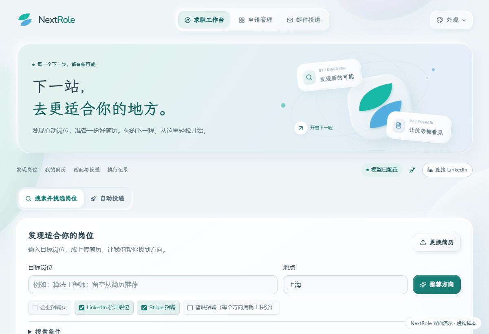
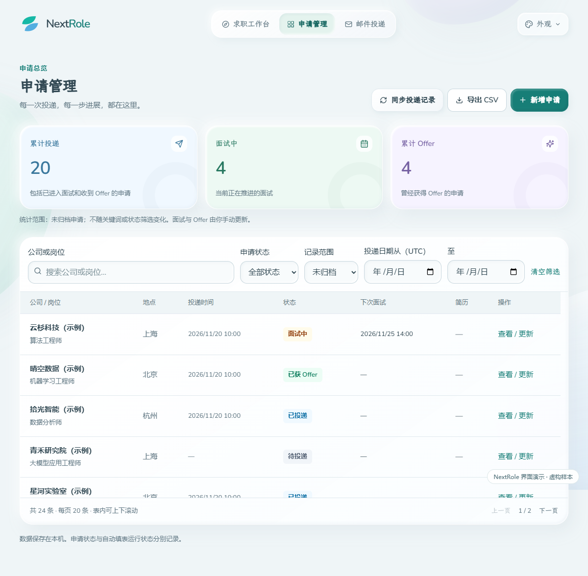
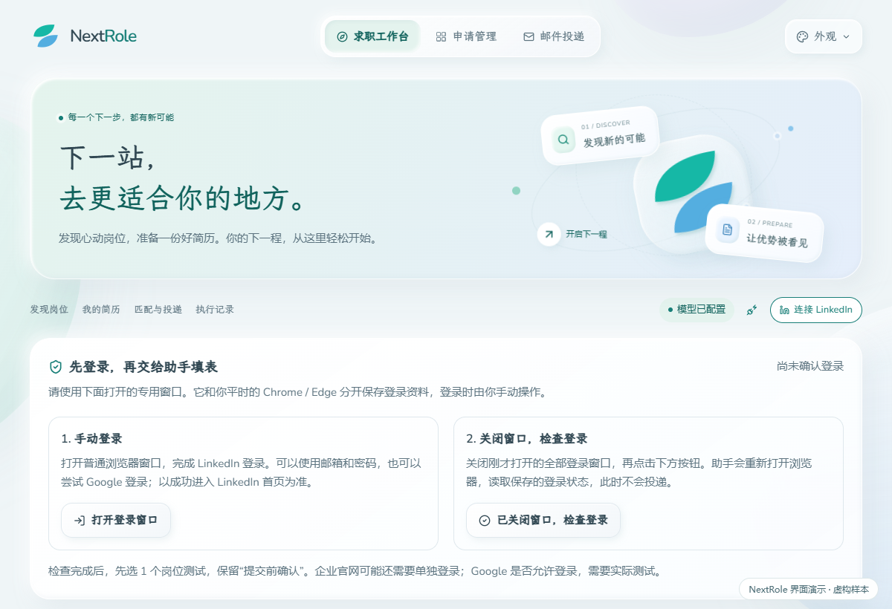
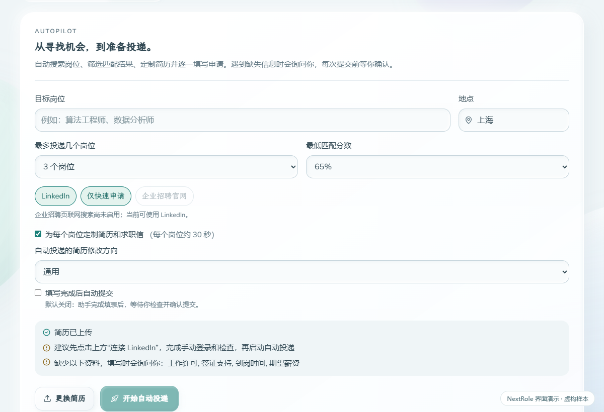

<div align="center">


# NextRole

**下一站，去更适合你的地方。**

中文优先的 AI 求职工作台：发现岗位、分析匹配、定制简历、辅助投递，让每一份申请都有进展可循。

[](https://github.com/rain2create/NextRole/actions/workflows/ci.yml)
[](LICENSE)


[界面演示](#界面演示) · [功能](#功能) · [快速开始](#快速开始) · [模型与搜索配置](#模型与搜索配置) · [开发文档](#开发文档)

</div>

## 界面演示



<p align="center">当前 NextRole 实际界面录制 · 约 10 秒循环 · 使用虚构样本，无真实简历、账号或投递</p>

<table>
  <tr>
    <td width="50%"><br/><b>求职工作台</b> · 搜索、简历和匹配集中处理</td>
    <td width="50%"><br/><b>申请管理</b> · 状态总表、面试安排、滚动与分页</td>
  </tr>
  <tr>
    <td><br/><b>两步登录</b> · 先完成登录，再复用会话填表</td>
    <td><br/><b>自动投递</b> · 按目标岗位与数量依次执行</td>
  </tr>
</table>

薄荷轻柔、雾紫云朵、清透留白三种外观可切换。顶部 Logo 和卡片轻浮，轨道缓慢旋转；鼠标划过空白底色时产生柔软起伏。支持关闭动效，触屏和系统减少动态效果时保持静态。

## 功能

| 模块 | 现在可以做什么 |
| --- | --- |
| 岗位发现 | 指定岗位与地点搜索，或根据简历推荐方向；支持条件筛选、收藏、跳过和撤销反馈 |
| 简历管理 | 上传 PDF / DOCX 或粘贴文本；管理原始简历与生成版本，支持移除上传记录 |
| 匹配分析 | 列表初评及详细匹配分析，展示经历证据、差距和待确认信息；两者评估粒度不同，分数不必相同 |
| 简历定制 | 通用、国企、大厂、外企方向；按方向或岗位 JD 生成 PDF，中英文输出及待确认译名审核 |
| 浏览器填表 | 填写字段、选择选项、上传附件；遇到缺失信息、登录或验证码时等待人工处理 |
| 自动投递 | 按目标岗位、地点、匹配门槛和数量，依次搜索、准备简历和填写申请；当前来源为 LinkedIn 与企业招聘页发现 |
| 申请管理 | 待投递、已投递、面试中、Offer、未通过、已撤回；支持总表、表内滚动与分页、筛选、时间线、归档和 CSV 导出 |
| 邮件投递 | 配置 SMTP 邮箱，准备并确认邮件内容和附件后发送；与浏览器填表分别执行 |

**浏览器申请默认在最终提交前等待确认。** 自动提交是单独选项，第一次试用建议保持关闭。面试和 Offer 目前由你手动更新，不会自动读取招聘平台反馈。

## 快速开始

需要 **Node.js 20.9+**、npm，以及本机安装的 **Chrome 或 Edge**。AI 功能需要可用的模型接口；申请总表和部分公开岗位来源可以独立使用。

```bash
git clone https://github.com/rain2create/NextRole.git
cd NextRole
npm install
```

复制 `.env.example` 为 `.env.local`，填写自己的模型配置。

```powershell
# Windows PowerShell
Copy-Item .env.example .env.local
npm run dev
```

macOS / Linux 使用 `cp .env.example .env.local`，然后运行 `npm run dev`。

打开 **[http://127.0.0.1:3000/app](http://127.0.0.1:3000/app)**。

1. 上传或粘贴简历，补充申请资料中的工作许可、到岗时间等信息。
2. 搜索岗位并查看匹配；需要时生成一份对应方向或岗位的简历。
3. 使用 LinkedIn 投递前，点击 **连接 LinkedIn → 打开登录窗口**，在专用窗口手动登录，确认进入 LinkedIn 首页。
4. 关闭刚才的全部专用登录窗口，再点 **已关闭窗口，检查登录**。日常 Chrome / Edge 的会话不会自动共享给助手。
5. 先选一个岗位测试填表，检查内容并确认提交；随后在 **申请管理** 维护后续进度。

Windows 长期使用可运行 `npm run build`，然后双击 `Start-NextRole.cmd`；重启使用 `Restart-NextRole.cmd`。更新代码后需要重新构建。

## 模型与搜索配置

最小示例：

```dotenv
QWEN_API_KEY=填入你自己的密钥
QWEN_MODEL=填入该接口可用的模型名称
QWEN_WEB_SEARCH=false
```

`QWEN_BASE_URL` 可覆盖默认地址。代码会为 `sk-sp-` 前缀的 Token Plan 密钥选择专用兼容端点；这不代表该套餐提供所有 API 能力，具体模型、接口和额度仍需分别验证。密钥只写在本机 `.env.local` 中。

| 能力 | 接口要求 / 配置 |
| --- | --- |
| 简历解析、方向推荐、匹配与定制 | Qwen 路径使用 Chat Completions 与结构化 JSON 输出 |
| 看网页并填表 | 使用图片输入和工具调用；可通过 `QWEN_AGENT_MODEL` 单独指定具备这些能力的模型 |
| 企业招聘页发现 | **当前仍调用 `/responses` 与 `web_search`**；仅当网关支持时开启 `QWEN_WEB_SEARCH=true`。Chat Completions 可用不等于此功能可用 |
| 其他兼容网关 | 未设置 `QWEN_API_KEY` 时，可配置 `OPENAI_API_KEY`、`OPENAI_BASE_URL`、模型名称及 `OPENAI_API_MODE=chat` 或 `responses` |
| 浏览器选择 | `BROWSER_CHANNEL=chrome` 或 `msedge`；两步手动登录需要安装 Chrome / Edge |
| 数据目录 | `NEXTROLE_DATA_DIR`，默认 `data/`；兼容旧的 `ROLEFLOW_DATA_DIR` |

岗位来源分别配置：

- **LinkedIn 公开职位**：无需模型密钥，但需要网络可达；公开搜索不使用登录窗口的 Cookie，登录不能保证消除 403 / 429。
- **Stripe 招聘**：读取 Stripe 的公开 Greenhouse 职位板，只覆盖这家公司的岗位。
- **智联招聘**：通过 API.SH，需要 `APISH_KEY`；每个方向请求第一页。
- **企业招聘页**：联网发现候选链接后，通过 Greenhouse、Lever、Ashby 公共接口核验。

更多说明见 [岗位搜索](docs/JOB_DISCOVERY.md) 与 [.env.example](.env.example)。

## 使用边界与数据

- NextRole 是**本机单用户应用**，不是多用户招聘平台。默认监听 `127.0.0.1`。
- 浏览器填表依赖网站结构和访问策略，不能保证每个表单都成功；Google 登录、验证码、企业官网账号和限流可能需要人工处理。
- 专用浏览器会保存登录资料。运行记录、简历、邮件配置等默认保存在 `data/`；`.env.local` 和 `data/` 均不纳入 Git。
- AI 操作会向所配置的模型服务发送相关简历、岗位内容，填表时还会发送网页快照。邮件授权码保存在本机，不交给模型。
- 总表中的“已投递”来自人工确认或助手报告的提交结果，不等同于招聘平台独立回执。

## 开发文档

```bash
npm run check             # lint、类型检查、核心测试
npm run test:tracking-ui  # 独立服务与临时数据的界面测试
npm run build             # 生产构建
```

测试需要浏览器：`npx playwright install chromium` 安装测试用 Chromium；使用系统 Chrome 时设置 `PW_CHANNEL=chrome`。UI 测试默认使用系统 Chrome。完整界面测试时将 `ROLEFLOW_UI_TEST_URL` 设为 `http://127.0.0.1:3101`；同一工作目录不能同时运行两个 Next.js 开发服务。

| 文档 | 内容 |
| --- | --- |
| [架构说明](docs/ARCHITECTURE.md) | 当前模块、模型接口、登录与填表流程 |
| [申请管理](docs/APPLICATION_TRACKING.md) | 状态模型、同步语义、API 与导出 |
| [岗位搜索](docs/JOB_DISCOVERY.md) | 搜索来源和首次试用 |
| [展示素材](docs/media/README.md) | GIF、截图与可复现录制方法 |
| [贡献指南](CONTRIBUTING.md) | 开发、测试与协作 |
| [安全说明](SECURITY.md) | 本机运行边界与漏洞报告 |
| [字体说明](public/fonts/README.md) | 本地字体、子集生成和许可 |

## 致谢与许可

NextRole 基于 [Roleflow](https://github.com/Deveshu04/roleflow) 发展，保留上游作者 Deveshu Pathak 的版权与 [MIT 许可证](LICENSE)。团队在此基础上开发中文工作流、岗位发现、简历定制、邮件投递、申请管理与全站视觉交互。

字体分别遵循其 OFL 许可。`video/` 和旧 `roleflow-demo.*` 素材是上游历史演示，当前产品展示以本 README 中的 NextRole 录屏为准。
