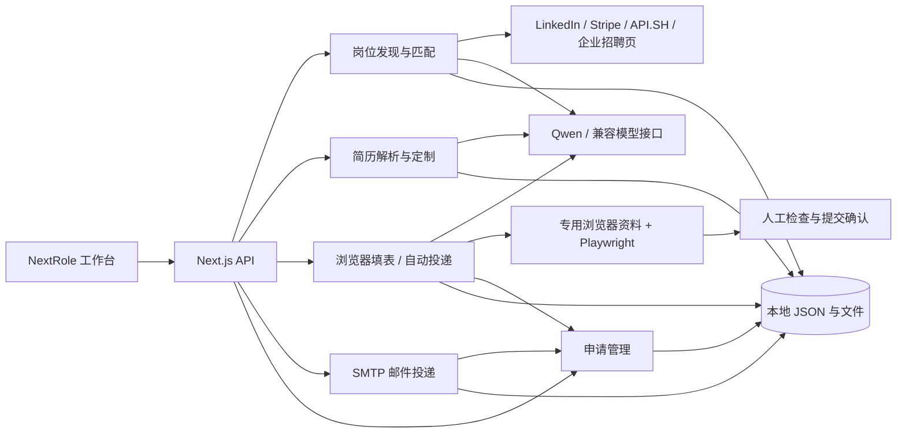

# NextRole 架构

NextRole 是本机运行的 Next.js 单用户求职工作台。前端统一使用中文导航、NextRole 双翼标志与可切换的柔态外观；服务端负责岗位发现、模型调用、浏览器填表、邮件投递和状态存储。

## 模块与数据流

| 位置 | 职责 |
| --- | --- |
| `public/landing/index.html` | 中文项目介绍页，通过 rewrite 映射到 `/` |
| `app/app/` | 求职工作台、申请管理 `/app/tracking`、邮件投递 `/app/email` |
| `app/appearance.*`、`app/ambient-surface.ts` | 三种主题、外观偏好、柔态背景及减少动效回退 |
| `app/api/` | 参数验证、服务入口与错误响应 |
| `lib/ai.ts`、`lib/config.ts` | 模型客户端、结构化输出、工具调用与配置 |
| `lib/jobs/` | 搜索、链接导入、ATS 核验、条件筛选、匹配、反馈 |
| `lib/resume/` | 解析、方向 / JD 定制、译名确认、PDF 渲染 |
| `lib/agent/` | 浏览器生命周期、页面快照、动作执行、任务状态、Autopilot |
| `lib/email/` | SMTP 配置验证、邮件准备与确认发送 |
| `lib/tracking/` | 申请状态、汇总、分页、时间线、同步与 CSV 导出 |
| `lib/store.ts` | JSON 与简历文件存储，投递结果同步入口 |

## 模型协议

优先使用 `QWEN_API_KEY`；未设置时可使用 `OPENAI_API_KEY` 的兼容配置。地址与模型由环境变量指定，Token Plan 前缀密钥会选择对应的默认端点。

| 场景 | 当前实现 |
| --- | --- |
| 解析、匹配、推荐、定制 | Qwen / chat 模式调用 Chat Completions，请求 JSON Schema 并用 Zod 验证；Responses 模式使用结构化 Responses 输出 |
| 浏览器决策 | `agentResponse()` 将文本、截图和函数工具转换为 Chat Completions 请求，或直接使用 Responses；返回工具动作交给执行器 |
| 联网发现 | `webSearch()` 独立调用 Responses 的 `web_search`，由 `QWEN_WEB_SEARCH` 控制；尚未提供通用搜索 API 替代层 |

文字生成、网页视觉工具调用、联网搜索是三个分别验证的能力。配置以 `lib/config.ts` 和 `.env.example` 为准；接口适配不代表任何套餐自动包含全部能力。

## 搜索与匹配

“搜索并挑选岗位”使用 `lib/jobs/discovery.ts`，支持 LinkedIn 公开职位、Stripe Greenhouse 职位板、API.SH 智联以及企业招聘页发现。公开搜索不复用浏览器登录态；简历推荐方向需要用户确认后才搜索。

列表初评用于快速排序，详细分析进一步结合完整岗位描述与简历证据，两者不是同一次评分。筛选、收藏和跳过反馈不会发起投递。

Autopilot 使用 `lib/jobs/search.ts` 的 LinkedIn / 企业招聘页路径，根据门槛选岗，并依次准备简历、启动申请。其来源不等同于手动搜索面板的全部来源。

## 简历与 PDF

原始简历和生成版本分开存储。方向模式需要简历与方向；岗位模式还需要有可用 JD 的岗位。岗位定制根据 JD 语言生成中文或英文输出，英文译名不确定时保留待审核稿，用户确认后才生成可下载版本。

PDF 通过无头浏览器渲染，与填表使用的可见浏览器分开。原始事实保护、技能筛选与结果验证在代码中执行。

## 两步登录

1. `/api/browser` 的 `linkedin-login` 打开普通 Chrome / Edge，使用专用 `browser-profile`；此时不附加自动化或远程调试参数。
2. 用户手动登录并退出专用窗口。`manual-login.json` 记录进程，页面轮询窗口是否退出，不在输入凭据期间读取浏览器内容。
3. `check-login` 通过 Playwright 重新打开同一资料目录，检查 LinkedIn 的 `li_at` Cookie。检查不创建申请或提交表单；Cookie 存在不等同于网站确认会话有效。
4. 填表继续使用持久资料。`browser-channel.json` 记录浏览器类型，避免 Chrome 和 Edge 交叉读取资料。

登录窗口未退出时阻止填表；有活动申请或 Autopilot 时，API 拒绝切换登录窗口。日常浏览器个人资料不会被导入。Google 或招聘站点仍可能要求重新登录或拒绝访问。

## 填表状态与执行

每一步读取页面可交互元素、校验信息与截图；模型返回填写、选择、点击、上传、询问或准备提交等动作。执行器验证动作并更新日志、截图与状态。

`running`、`needs_input`、`blocked`、`awaiting_approval` 属于活动状态；结果可能为 `submitted`、`failed` 或 `cancelled`。默认等待提交确认，自动提交是独立选项。验证码与登录由用户完成。任务有步数、令牌与重试上限。

活动控制器保存在进程内，不会跨服务重启继续执行；磁盘记录用于历史展示。API 将未存活的活动记录显示为中断失败。

## 申请管理与邮件

招聘进度与填表运行状态分别存储：总表状态为 `saved / applied / interviewing / offer / rejected / withdrawn`。面试、Offer 等后续进展由用户维护。

`saveRun()` 在任务报告提交成功后调用幂等同步。同步失败不会重新向招聘站提交；可从页面补同步。总表提供版本号冲突检测、归档、固定表头、表内滚动、20 条分页与 CSV 导出。详见 [申请管理](APPLICATION_TRACKING.md)。

邮件通过 SMTP 发送，需确认收件人、正文与附件；SMTP 授权码保存在本机配置文件，不交给模型，不支持强制 OAuth 的邮箱登录流程。

## 存储与运行边界

默认目录 `data/`，可用 `NEXTROLE_DATA_DIR` 覆盖，旧 `ROLEFLOW_DATA_DIR` 仍兼容。包含简历、岗位、运行记录、申请总表、邮件配置、浏览器资料等；全部在 Git 忽略范围内。

设计面向单用户、单 Node 服务进程，不是可直接公开部署的多用户服务。`proxy.ts` 限制本机来源，URL 校验阻止自动访问本机与内网地址。详见 [安全说明](../SECURITY.md)。

## 验证与展示

- `npm run check`：静态检查与核心测试。
- `npm run test:tracking-ui`：临时数据和 3101 端口的界面测试；完整运行需设置 `ROLEFLOW_UI_TEST_URL=http://127.0.0.1:3101`。
- `npm run build`：生产构建。
- `scripts/capture-showcase.cjs`：拦截所有 API，以虚构数据录制 UI，不调用模型、不发送邮件、不投递。
